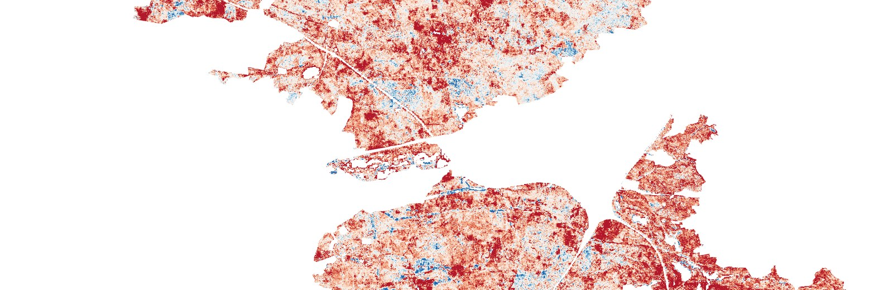

::: {.hero-banner}
{fig-alt="Map of canopy moisture change in the Nürnberger Reichswald, 2017–2020"}
:::

::: {.lead-text}
How is climate change showing up in the forests, streets and rivers of the Nürnberg–Fürth–Erlangen metropolitan area? This atlas answers that with **open satellite data** (Copernicus Sentinel-2, ESA WorldCover) processed in **Google Earth Engine and Python**, one case study at a time.
:::

## Case studies

::: {#cases}
:::

## Latest findings: Nürnberger Reichswald

:::: {.grid}

::: {.g-col-12 .g-col-md-4}
::: {.stat-card}
[2020]{.key-number}

The low point of canopy moisture (NDMI) after three consecutive drought summers (2018–2020).
:::
:::

::: {.g-col-12 .g-col-md-4}
::: {.stat-card}
[45 %]{.key-number}

of forest pixels had a summer NDMI in 2020 more than 0.05 below 2017.
:::
:::

::: {.g-col-12 .g-col-md-4}
::: {.stat-card}
[92 %]{.key-number}

of the high wildfire-susceptibility class is pine, concentrated along roads and settlement edges.
:::
:::

::::

[Read the full case study →](projects/01_reichswald.qmd){.btn .btn-primary .mt-3}

::: {.author-strip}
**About the author.** Iván Alonso, geographer and remote sensing specialist based near Erlangen (MSc Environmental & Climate Sciences, FAU). [More about me](about.qmd) · [Code on GitHub](https://github.com/ivan-alonso-rs/climate-risk-atlas-nfe) · [LinkedIn](https://www.linkedin.com/in/ivan-alonso-rs/)
:::

---

**Kurzfassung (Deutsch):** Dieser Atlas zeigt mit offenen Satellitendaten, wie sich der Klimawandel in Wäldern, Städten und Gewässern der Metropolregion Nürnberg–Fürth–Erlangen bemerkbar macht. Erste Fallstudie: Waldzustand und Waldbrandanfälligkeit im Nürnberger Reichswald.
