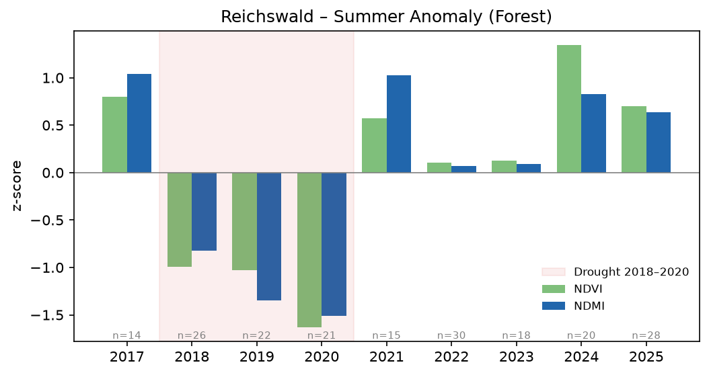
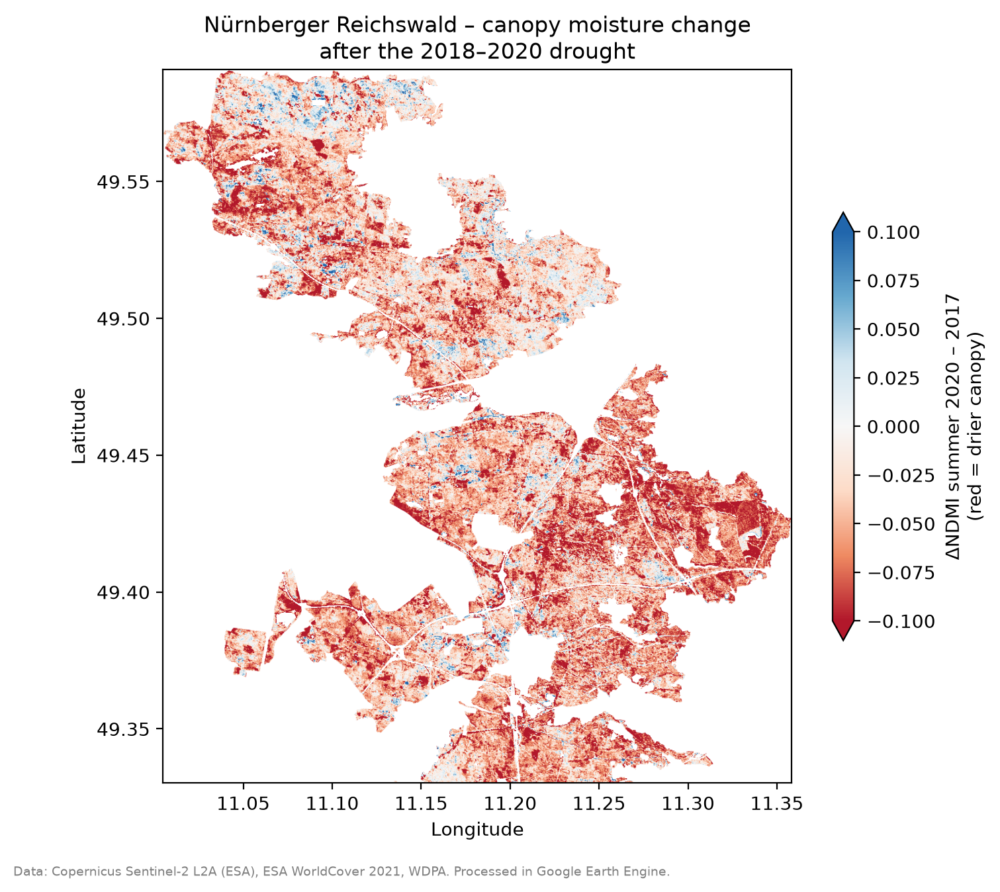
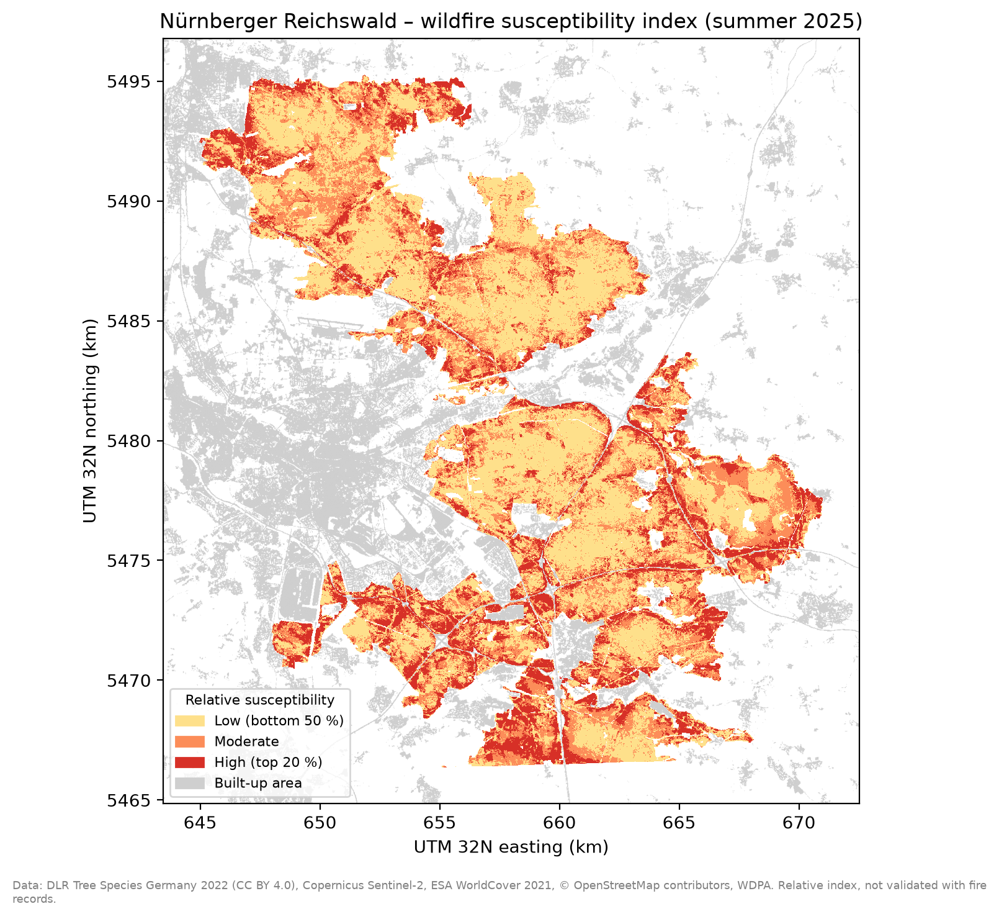

::: {.callout-tip}
## Key findings
- **2018–2020 drought:** summer canopy moisture (NDMI) and greenness (NDVI) were below average in all three years, with the **low point in 2020**. Forest-wide values returned to normal from 2021.
- **45 % of forest pixels** had a 2020 summer NDMI more than 0.05 below 2017. The loss is widespread, and some sharp-edged patches point to harvesting.
- **Wildfire susceptibility** is highest in **pine stands along motorways, main roads and settlement edges**. Pine is 58 % of the forest but 92 % of the high class.
- Method and code: [notebook 1](https://github.com/ivan220/climate-risk-atlas-nfe/blob/main/notebooks/01_reichswald_ndvi_ndmi.ipynb) · [notebook 1b](https://github.com/ivan220/climate-risk-atlas-nfe/blob/main/notebooks/01b_reichswald_fire_susceptibility.ipynb)
:::

## Problem

The Nürnberger Reichswald (~280 km²) surrounds Nürnberg, Fürth and Erlangen and is dominated by pine on sandy, water-poor soils. It provides recreation, drinking water protection and cooling for more than a million people. Central Europe went through an exceptional multi-year drought in 2018–2020 (Rakovec et al. 2022), with widespread forest damage (Schuldt et al. 2020).

**Questions:** can open satellite data show when and where the Reichswald lost canopy vitality and moisture, and whether it recovered? And which parts of the forest are most susceptible to wildfire?

## Data

| Dataset | Use |
|---|---|
| Copernicus Sentinel-2 L2A (harmonized), 2017–2025 | Summer reflectance (June–August), 10–20 m |
| ESA WorldCover 2021 | Forest mask (tree cover class) |
| WDPA – Natura 2000 "Nürnberger Reichswald" | Study area boundary |
| DLR Tree Species Germany 2022 (10 m) | Fuel type (wildfire index) |
| OpenStreetMap roads, ESA WorldCover built-up | Human ignition proxies (wildfire index) |
| SRTM 30 m | Slope check |

Processing was done in Google Earth Engine and Python (rasterio, geopandas). Code: [`01_reichswald_ndvi_ndmi.ipynb`](https://github.com/ivan220/climate-risk-atlas-nfe/blob/main/notebooks/01_reichswald_ndvi_ndmi.ipynb) and [`01b_reichswald_fire_susceptibility.ipynb`](https://github.com/ivan220/climate-risk-atlas-nfe/blob/main/notebooks/01b_reichswald_fire_susceptibility.ipynb), with reusable functions in [`src/`](https://github.com/ivan220/climate-risk-atlas-nfe/tree/main/src).

## Method

1. For each summer (1 June – 31 August), select Sentinel-2 scenes with < 40 % cloud cover and mask clouds and shadows with the Scene Classification Layer (vegetation and bare-soil pixels only).
2. Build a median composite and compute two indices:
   - **NDVI** = (NIR − Red) / (NIR + Red): greenness / vitality.
   - **NDMI** = (NIR − SWIR1) / (NIR + SWIR1): canopy water content (Gao 1996; Wilson & Sader 2002).
3. Average both indices over forest pixels and express each year as a **standardized anomaly** (z-score) relative to 2017–2025, so both indices can be compared on the same scale.
4. Map the pixel-wise change **ΔNDMI = NDMI 2020 − NDMI 2017** (driest year vs. first available year).

## Results

{#fig-anomalies}

- **2018, 2019 and 2020 were all below average** in both indices. The low point was **2020** (z = −1.6 for NDVI, −1.5 for NDMI), not the hotter year 2018: this is consistent with a cumulative effect of three consecutive dry summers.
- Mean summer NDMI dropped from **0.33 (2017) to 0.28 (2020)**; NDVI from **0.81 to 0.77**.
- From **2021 onwards** the forest-wide averages returned to or above the 2017–2025 mean; **2024 had the highest NDVI** of the series.
- The 2020 minimum is not an artefact of data availability: 2020 had 21 usable scenes, a typical number.

```{=html}
<iframe src="figures/reichswald_dndmi_map.html" width="100%" height="520" style="border:none" title="Interactive map of NDMI change 2020–2017"></iframe>
```

*Interactive map: change in summer NDMI between 2017 and 2020. Red = drier canopy in 2020. Use the layer control (top right) to switch basemaps or hide the overlay.*

- In **45 % of forest pixels**, summer NDMI in 2020 was more than 0.05 below 2017.
- The loss is **widespread across the whole forest**, not limited to its edges.
- Some of the strongest losses form **sharp, rectangular patches**. These shapes point to harvesting or sanitation felling of damaged stands rather than drought stress alone.

::: {.callout-note collapse="true"}
## Static version of the map


:::

## Wildfire susceptibility

Where would a fire be most likely to start and find dry, flammable fuel? Following the framework of Chuvieco et al. (2010), a **static, relative susceptibility index** combines human ignition probability with fuel conditions:

| Factor | Data | Scaling (0–1) |
|---|---|---|
| Fuel type | DLR Tree Species Germany 2022, 10 m | pine 1.0 · other conifers 0.6 · broadleaves 0.3 · canopy-cover loss 0.8 |
| Fuel moisture | Per-pixel z-score of summer 2025 NDMI vs. 2017–2025 (Yebra et al. 2013) | z = −2 → 1, z = +2 → 0 |
| Human ignition | Distance to roads (OpenStreetMap) and built-up areas (ESA WorldCover) | exponential decay (300 m / 500 m) |

The three factors are averaged with equal weights. Pixels are then ranked into **relative classes**: high = top 20 %, moderate = next 30 %, low = bottom 50 %. Three candidate factors were left out after checking the data:

- **Slope:** the terrain is almost flat (median slope 3°, 90th percentile 7°).
- **Forest tracks:** 90 % of the forest lies within ~120 m of one, so this factor does not discriminate between areas.
- **Weather:** it changes daily and is covered by the DWD forest fire danger index (*Waldbrandgefahrenindex*).

{#fig-fire}

```{=html}
<iframe src="figures/reichswald_fire_map.html" width="100%" height="520" style="border:none" title="Interactive wildfire susceptibility map"></iframe>
```

- Pine makes up **58 %** of the analysed forest (271 km²) but **92 %** of the high-susceptibility class.
- High values concentrate **along motorways and main roads and at the forest–settlement interface**, especially in the southern part (Feucht–Wendelstein area) and the north-western edge towards Erlangen.
- **Sensitivity check:** the result is robust to the main assumptions. With doubled weights for any single factor, or with halved or doubled decay distances, the rank correlation with the base index stays between 0.91 and 0.99, and 81–94 % of high-class pixels remain high.

## Recommendation for the municipality

- **Use summer NDMI from Sentinel-2 as a free, annual early-warning indicator** of canopy water stress in the Reichswald. It can be updated each September at no data cost.
- **Prioritise field inspections** in areas with strong and persistent NDMI loss, and cross-check them with forest management records (Bayerische Staatsforsten) to separate drought damage from planned harvesting.
- **Focus fire prevention on the high-susceptibility belt along roads and settlement edges.** Useful measures include fuel management, signage on high-danger days and access routes for fire services. The long-term option is the gradual conversion of pure pine stands to mixed forest.

## Limitations

- **Single forest mask (WorldCover 2021).** Stands cleared during 2019–2020 may no longer be classified as forest and are excluded, so the "recovery" after 2021 may look more complete than it is on the ground.
- **The 2017 baseline was wetter than average** (z = +1.0 for NDMI) and had the fewest scenes (14). Comparing against 2017 therefore somewhat overstates the 2020 decline.
- **The −0.05 ΔNDMI threshold is indicative**, not a calibrated damage threshold. No field data were used for validation.
- **Satellite indices cannot tell causes apart:** drought stress, bark beetle, harvesting and storm damage can all lower NDMI.
- Nine summers are too few for a robust trend analysis; results are descriptive.
- **The wildfire index is relative and not validated.** Fuel scores, decay distances and weights are expert assumptions (tested in the sensitivity check). Too few mapped fires exist in the area to calibrate it against real ignitions. In Germany the cause of most forest fires is not determined; where it is known, human negligence is the most frequent.
- The index is **static**: it shows *where* fires are more likely, not *when*. Daily fire danger depends on weather (DWD *Waldbrandgefahrenindex*).
- OpenStreetMap completeness and the 2022 species map (overall F1 = 0.89) carry their own errors.

## References

- Chuvieco, E. et al. (2010). Development of a framework for fire risk assessment using remote sensing and geographic information system technologies. *Ecological Modelling*, 221(1), 46–58. doi:10.1016/j.ecolmodel.2008.11.017
- DLR (2025). *Tree Species Germany 2022* [dataset, 10 m, CC BY 4.0]. German Aerospace Center, EOC Geoservice.
- Romero-Calcerrada, R. et al. (2008). GIS analysis of spatial patterns of human-caused wildfire ignition risk in the SW of Madrid (Central Spain). *Landscape Ecology*. doi:10.1007/s10980-008-9190-2
- Yebra, M. et al. (2013). A global review of remote sensing of live fuel moisture content for fire danger assessment: Moving towards operational products. *Remote Sensing of Environment*, 136, 455–468. doi:10.1016/j.rse.2013.05.029
- Gao, B.-C. (1996). NDWI — A normalized difference water index for remote sensing of vegetation liquid water from space. *Remote Sensing of Environment*, 58(3), 257–266.
- Rakovec, O. et al. (2022). The 2018–2020 multi-year drought sets a new benchmark in Europe. *Earth's Future*, 10, e2021EF002394.
- Schuldt, B. et al. (2020). A first assessment of the impact of the extreme 2018 summer drought on Central European forests. *Basic and Applied Ecology*, 45, 86–103.
- Wilson, E. H. & Sader, S. A. (2002). Detection of forest harvest type using multiple dates of Landsat TM imagery. *Remote Sensing of Environment*, 80(3), 385–396.

---

## Kurzfassung (Deutsch)

Mit Sentinel-2-Daten (2017–2025) wurde der Sommerzustand des Nürnberger Reichswalds untersucht. Die Indizes NDVI (Vitalität) und NDMI (Wassergehalt der Baumkronen) lagen in den Dürrejahren 2018–2020 durchgehend unter dem Durchschnitt, mit dem Tiefpunkt im Jahr 2020. Auf 45 % der Waldfläche lag der NDMI 2020 um mehr als 0,05 unter dem Wert von 2017. Ab 2021 erreichten die Mittelwerte wieder das Niveau der Vorjahre. Einige scharf begrenzte Flächen deuten auf Holzeinschlag statt reinen Trockenstress hin. Ein relativer Waldbrand-Anfälligkeitsindex (Baumart, Feuchte, Nähe zu Straßen und Siedlungen) zeigt die höchsten Werte in Kiefernbeständen entlang von Autobahnen, Hauptstraßen und Siedlungsrändern. Empfehlung: den NDMI jährlich als kostenlosen Frühwarnindikator nutzen, mit Forstdaten abgleichen und die Brandvorsorge auf diese Randzonen konzentrieren.
