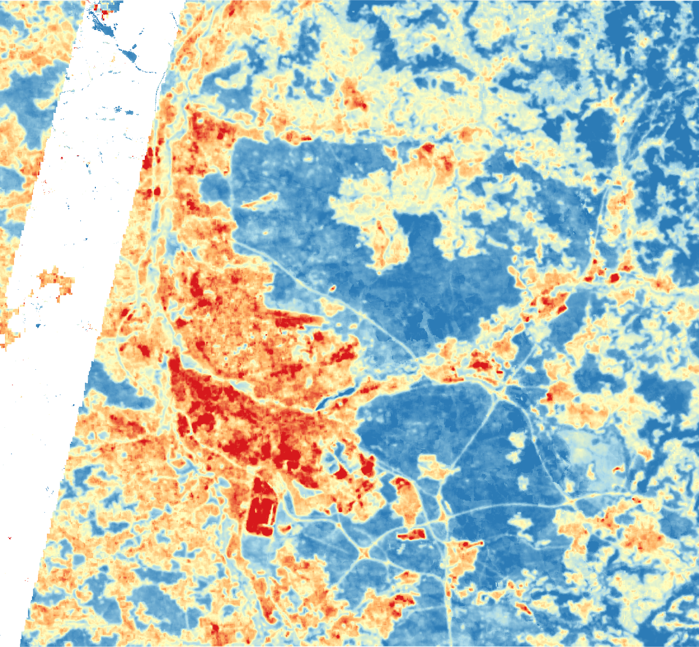

::: {.callout-tip}
## Key findings
- **Built-up areas are about 7 °C hotter than forest** in summer: mean land surface temperature (LST) of 34.0 °C vs. 26.8 °C for tree cover (Landsat 8/9, around 10:30 local time).
- **53 % of the residents** of the covered area (about 574,000 of 1.08 million) live in the **hottest 10 % of the territory** (LST ≥ 33.9 °C).
- The Nürnberger Reichswald, rivers and water bodies form the cool end of the temperature range.
- Method and code: [notebook 2](https://github.com/ivan-alonso-rs/climate-risk-atlas-nfe/blob/main/notebooks/02_urban_heat.ipynb)
:::

## Problem

Cities are warmer than their surroundings, mainly because sealed surfaces store heat and there is less vegetation and water to cool the air (Oke 1982). Heat is a health risk, particularly for older people and for people without access to cool places. For a municipality, the first question is spatial: **where are the hottest areas, and how many people live in them?**

## Data

| Dataset | Use |
|---|---|
| Landsat 8 and 9, Collection 2 Level 2 (`ST_B10`), summers 2018–2025 | Land surface temperature, 30 m (thermal band resampled from 100 m) |
| ESA WorldCover 2021 (v200) | Land cover classes |
| GHSL GHS-POP 2020 (R2023A), 100 m | Modelled population per grid cell |

Processing was done in Google Earth Engine and Python. Code: [`02_urban_heat.ipynb`](https://github.com/ivan-alonso-rs/climate-risk-atlas-nfe/blob/main/notebooks/02_urban_heat.ipynb), with reusable functions in [`src/landsat_utils.py`](https://github.com/ivan-alonso-rs/climate-risk-atlas-nfe/blob/main/src/landsat_utils.py).

## Method

1. For each year 2018–2025, select Landsat 8/9 scenes between 15 May and 15 September, mask cloud, shadow, cirrus, snow and fill pixels with the QA band, and convert `ST_B10` to °C.
2. Take the **median per summer**, then the **mean of the eight summers**, to reduce the effect of individual hot or cool days.
3. Average LST by **WorldCover class** to link temperature to land cover.
4. Aggregate LST to the 100 m population grid and define **hotspots as the hottest 10 % of cells** (90th percentile of LST). Sum the population in hotspot cells.

## Results

```{=html}
<iframe src="figures/urban_heat_lst_map.html" width="100%" height="520" style="border:none" title="Interactive map of mean summer land surface temperature"></iframe>
```

*Interactive map: mean summer LST 2018–2025. Use the layer control (top right) to switch basemaps or hide the overlay. The black strip in the west has no thermal data (see Limitations).*

| Land cover | Mean LST (°C) |
|---|---|
| Tree cover | 26.8 |
| Herbaceous wetland | 27.4 |
| Water | 27.6 |
| Grassland | 30.3 |
| Cropland | 31.3 |
| Bare | 31.5 |
| **Built-up** | **34.0** |

- The temperature gradient follows land cover: **forest and water are coolest, built-up land hottest**, with a difference of about 7 °C between tree cover and built-up land.
- The hottest patches are the dense core of Nürnberg and large sealed areas such as industrial and logistics sites.
- The hotspot threshold (90th percentile) is **33.9 °C**. About **574,000 of 1,081,000 residents (53 %)** live in cells above it, although these cells are only 10 % of the area. Heat is concentrated where people live.

::: {.callout-note collapse="true"}
## Static version of the map


:::

## Recommendation for the municipality

- **Use this map to prioritise heat-adaptation measures** (trees and shade, unsealing, cool or green roofs, water features) in the hottest residential districts rather than spreading them evenly.
- **Protect the cool areas.** The Reichswald and river corridors are the coolest parts of the region and should be kept connected to the built-up area.
- **Combine this map with social data** (age structure, income, housing quality) before deciding where to act: exposure to heat is not the same as vulnerability. The 2022 census grid is the obvious next layer.
- Hotspots with few residents, such as industrial and commercial areas, call for different measures than residential ones (for example, reducing sealing and improving surfaces).

## Limitations

- **LST is not air temperature.** It is the temperature of the surface seen by the satellite and is higher than air temperature on sunny surfaces, especially sealed ones (Voogt & Oke 2003).
- **Daytime only.** Landsat passes at about 10:30 local time. For health, night-time temperatures matter most, and they are not observed here.
- **Resolution.** The thermal band has 100 m pixels (resampled to 30 m); street-level differences are not resolved.
- **Data gap in the west.** Landsat 8/9 Level 2 surface temperature is not available in Earth Engine for a strip along the western edge of the study area (neither Tier 1 nor Tier 2 scenes). This strip is excluded and the population figures refer to the covered area only.
- **Modelled population.** GHS-POP is a modelled (disaggregated) population grid, not a census count. The estimate of residents in hotspots is therefore approximate.
- **Hotspot definition.** The 10 % threshold is a convention, and the share of people living in hotspots depends on it. It says nothing about absolute health risk.
- **Age was not included.** Population age (for example, over 65) was not available in a usable form, so the analysis measures exposure of residents, not vulnerability.
- Eight summers are a composite of typical conditions, not an analysis of individual heat waves.

## References

- Oke, T. R. (1982). The energetic basis of the urban heat island. *Quarterly Journal of the Royal Meteorological Society*, 108(455), 1–24. [doi:10.1002/qj.49710845502](https://doi.org/10.1002/qj.49710845502)
- Schiavina, M., Freire, S., Carioli, A. & MacManus, K. (2023). *GHS-POP R2023A – GHS population grid multitemporal (1975–2030)* [dataset]. European Commission, Joint Research Centre. [doi:10.2905/2FF68A52-5B5B-4A22-8F40-C41DA8332CFE](https://doi.org/10.2905/2FF68A52-5B5B-4A22-8F40-C41DA8332CFE)
- Voogt, J. A. & Oke, T. R. (2003). Thermal remote sensing of urban climates. *Remote Sensing of Environment*, 86(3), 370–384. [doi:10.1016/S0034-4257(03)00079-8](https://doi.org/10.1016/S0034-4257(03)00079-8)
- Zanaga, D. et al. (2022). *ESA WorldCover 10 m 2021 v200* [dataset]. [doi:10.5281/zenodo.7254221](https://doi.org/10.5281/zenodo.7254221)

---

## Kurzfassung (Deutsch)

Mit Landsat-8/9-Daten (Sommer 2018–2025) wurde die Oberflächentemperatur in Nürnberg, Fürth und Erlangen kartiert. Bebaute Flächen sind im Mittel etwa 7 °C wärmer als Wald (34,0 °C gegenüber 26,8 °C). Die heißesten 10 % der Fläche (ab 33,9 °C) beherbergen rund 53 % der Einwohner des untersuchten Gebiets (ca. 574 000 von 1,08 Mio.). Einschränkungen: Oberflächentemperatur ist nicht Lufttemperatur, es wird nur die Tagessituation (ca. 10:30 Uhr) erfasst, die Bevölkerungsdaten (GHS-POP) sind modelliert, und ein Streifen im Westen ist ohne Daten. Empfehlung: Anpassungsmaßnahmen (Bäume, Entsiegelung, Begrünung) in den heißesten Wohnquartieren priorisieren und die kühlen Flächen wie den Reichswald schützen.
