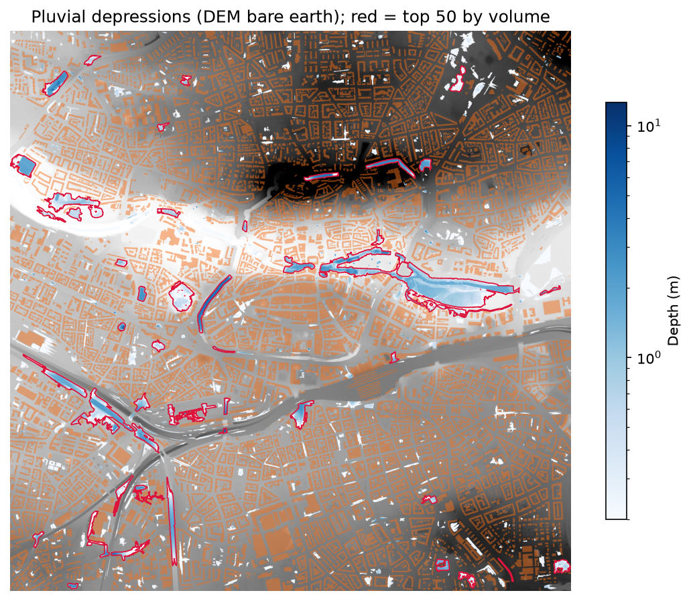
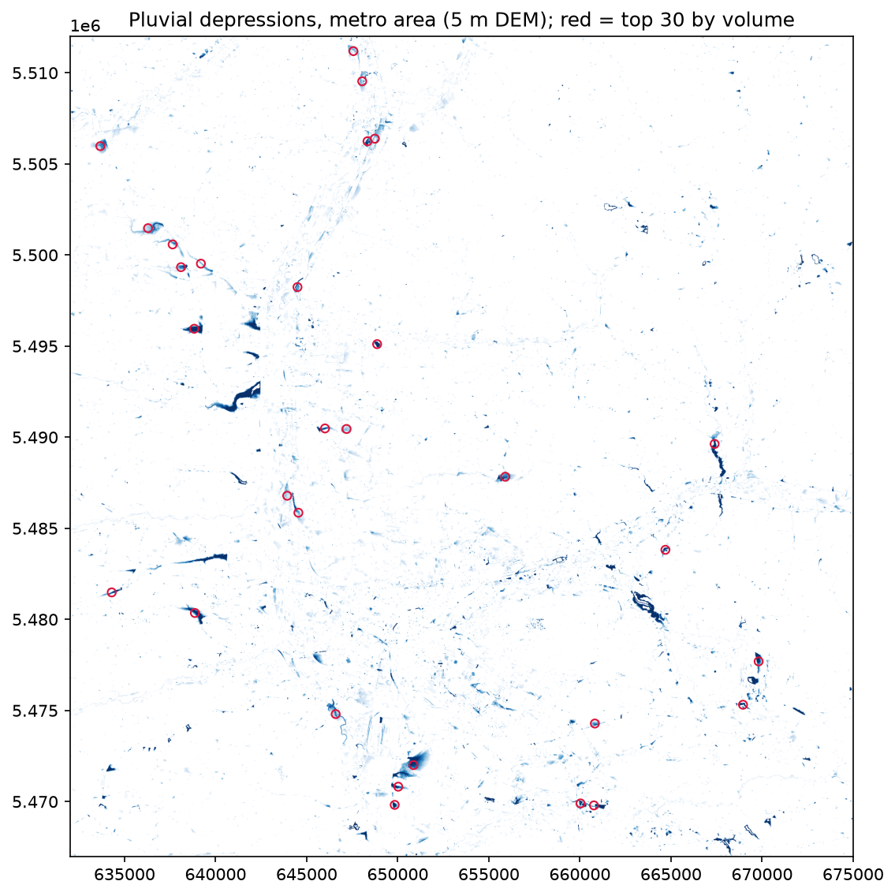
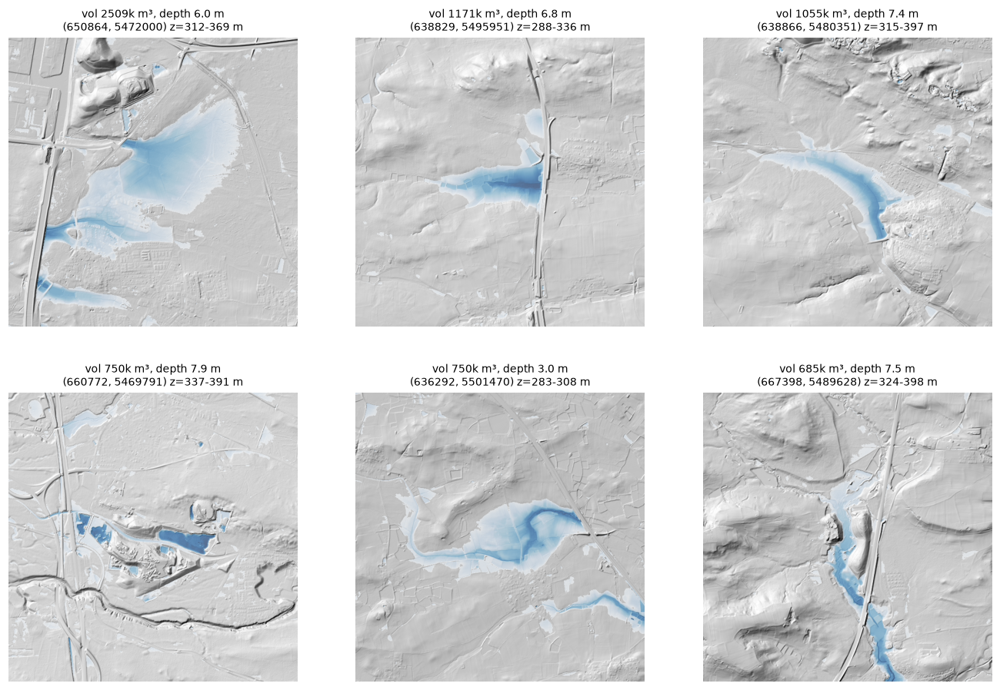

::: {.callout-tip}
## Key findings
- **About 27,900 terrain depressions** (≥ 0.20 m deep) were found in a 43 × 45 km area, covering 62 km² with a modelled volume of 37 million m³.
- **The largest depressions are mostly artefacts, not flood spots.** The six largest (0.7 to 2.5 million m³, 3 to 8 m deep) were inspected on a hillshade: most are valleys closed by road or railway embankments, which a bare-earth DEM treats as dams, and one matches a quarry. Because they dominate the total, **the 37 million m³ is an upper bound, not a storage estimate**.
- **Obvious filters did not fix this.** Masking water (OpenStreetMap) and lakes or bare ground (WorldCover) removed only 139 depressions. Ranking by fill ratio or by catchment area did not work either (see Results).
- Method and code: [`src/pluvial.py`](https://github.com/ivan-alonso-rs/climate-risk-atlas-nfe/blob/main/src/pluvial.py)
:::

## Problem

Heavy rain can flood streets and basements far from any river, wherever surface runoff collects in a topographic low (pluvial flooding). A municipality needs a first, cheap answer to: **where are the terrain depressions in which runoff accumulates, and which of them matter for people and buildings?** This case study is a screening on elevation data, not a flood forecast.

## Data

| Dataset | Use |
|---|---|
| Laser-scanning bare-earth DEM (Bavarian DGM1 tiles): 1 m for a pilot, 5 m for the metropolitan area (43 × 45 km) | Terrain |
| OpenStreetMap via the Overpass API | Building footprints and permanent water |
| ESA WorldCover 2021 (v200), 10 m | Water and bare-ground classes, to check the largest depressions |

## Method and scientific rationale

1. **Depression filling.** The DEM is filled with a priority-flood-type algorithm, implemented as morphological reconstruction (Vincent 1993; equivalent in result to Wang & Liu 2006). *Filled minus original* gives each depression's depth, area and volume, that is, the water it can hold before spilling.
2. **Minimum depth of 0.20 m.** Shallower sinks are mostly vertical noise in the DEM, not real storage.
3. **Buildings: used for routing, not for depth.** Runoff cannot cross buildings, so OSM building footprints were raised by 10 m in a copy of the DEM, used only for the **flow routing** (D8 flow accumulation, O'Callaghan & Mark 1984). My first attempt also computed depth on the raised DEM; it produced 10 to 12 m deep "wells" in courtyards, an artefact of the added height. **Depths are therefore computed on the original DEM.** Depressions with more than 20 % of their area under buildings are discarded as DEM or footprint inconsistencies.
4. **Water and excavations.** Depressions with more than 20 % OSM water are discarded because rivers and lakes are not pluvial hazards. As a second check, depressions with more than 30 % WorldCover water or more than 50 % bare ground were also removed.
5. **Depth ceiling (metropolitan area).** The raw result contained excavations such as quarries 29 and 74 m deep. Depressions deeper than 8 m (56 in total) were discarded.
6. **Ranking.** Two further quantities were computed: the upstream catchment (maximum flow accumulation inside each depression) and the **fill ratio** (catchment ÷ volume), meant to flag a lot of runoff for little storage. Both turned out unusable as a ranking (see Results), so depressions are ordered by **volume**.
7. **Visual validation.** The largest depressions were inspected on a hillshade rather than trusting the numbers.

## Results

### Pilot: Nürnberg–Fürth urban core (1 m, 4 × 4 km)

The 1 m pilot covers a 4 × 4 km window in the centre of the pilot area, because the full 11 × 11 km grid (128 million cells) was too heavy for the flow-routing library. After the size filters (≥ 50 m³ or ≥ 100 m²) and the building filter, **818 depressions** remain. They sit in parks, road and railway cuttings and along the river, which is plausible. The largest holds about 158,000 m³ (3.4 m deep, 0.66 km² catchment) and looks like a real basin. The deepest (12.6 m) is a trench or quarry-like feature that could be a real underpass or a DEM artefact; this was not resolved. The river channel also appears as a depression, because the pilot did not mask water.

### Metropolitan area (5 m)

- **27,932 depressions** remain, with a modelled volume of 37.2 million m³ over 62.2 km². Half are shallower than 0.40 m; 4,313 are at least 1 m deep.
- OSM building and water masks cover 3.5 % and 1.3 % of the area.
- The WorldCover check removed only **139 depressions** and did not touch the top of the ranking: the ten largest have 0 to 12 % water and 0 to 18 % bare ground. My first hypothesis, that they were unmapped gravel pits or fish ponds, was wrong.
- **Ranking by catchment fails:** it returns depressions of 100 to 1,800 m² with a catchment of about 155 km², which is the Pegnitz/Regnitz main channel collecting everything upstream, not a place where water ponds. **Ranking by fill ratio fails** in the pilot: the top places are 1 m³ depressions lying on large flow paths.

### What the largest depressions really are

From the hillshade alone (no orthophoto), the six largest are:

1. A wide basin at a motorway junction with a quarry or fill to the north; partly real, but closed by infrastructure.
2. A valley closed by a road or motorway embankment: a clear case of a "dam" (the model raises water 6.8 m behind it).
3. An enclosed valley behind an embankment or built-up area; the mechanism is plausible but less clear.
4. A shape that matches a quarry or industrial compound rather than a valley.
5. A valley closed by a linear route on one side; probably an embankment.
6. A swale crossed by a motorway; possibly closed by an embankment or bridge.

Culverts, bridges and underpasses are not in a bare-earth DEM, so water "fills a reservoir" behind the embankment that in reality drains. **These depths of 6 to 8 m are an artefact of the method, not real ponding.**

## Recommendation for the municipality

- **Do not use the largest depressions as hazard areas.** At this stage the map is useful for the shallow, local depressions (the pilot shows them in cuttings, underpasses and parks), not for valley-scale ones.
- **Breach embankments before ranking.** Lower the DEM in a narrow corridor where OSM roads and railways cross a stream, then repeat the depression analysis. This is the next step and was tested neither in the pilot nor at metropolitan scale.
- **Define a ranking that is not dominated by the main stream or by volume**, for example using local catchments that exclude the Pegnitz/Regnitz channel.
- **Verify any shortlist** with a 2D rainfall–runoff simulation and records of past flooding before investment or planning decisions.

## Limitations

- **A topographic screening, not a flood model.** Rainfall, infiltration, sealing, sewer capacity and flow dynamics are not modelled.
- **Embankments and culverts are not corrected.** This is a known issue with LiDAR DEMs (Lindsay & Dhun 2015) and dominates the largest results here.
- **The top-six inspection is visual**, on a hillshade without orthophoto, so the causes are probable, not confirmed.
- **Resolution and extent.** The 5 m DEM misses narrow features. The 1 m pilot resolves them but covers only 4 × 4 km, and does not mask water.
- **Thresholds are judgement calls** (0.20 m, 20 % buildings and water, 30 % WorldCover water, 50 % bare ground, 8 m depth ceiling, minimum size in the pilot). They were set by inspection and not tuned against observed flooding.
- **OSM completeness.** Buildings were rasterised from simple closed ways only; multipolygon buildings are missed. Overpass queries were run in 9 tiles with retries.
- **No validation against flood records** has been done.

## References

- Lindsay, J. B. & Dhun, K. (2015). Modelling surface drainage patterns in altered landscapes using LiDAR. *International Journal of Geographical Information Science*, 29(3), 397–411. [doi:10.1080/13658816.2014.975715](https://doi.org/10.1080/13658816.2014.975715)
- O'Callaghan, J. F. & Mark, D. M. (1984). The extraction of drainage networks from digital elevation data. *Computer Vision, Graphics, and Image Processing*, 28(3), 323–344. [doi:10.1016/S0734-189X(84)80011-0](https://doi.org/10.1016/S0734-189X(84)80011-0)
- Vincent, L. (1993). Morphological grayscale reconstruction in image analysis: applications and efficient algorithms. *IEEE Transactions on Image Processing*, 2(2), 176–201. [doi:10.1109/83.217222](https://doi.org/10.1109/83.217222)
- Wang, L. & Liu, H. (2006). An efficient method for identifying and filling surface depressions in digital elevation models for hydrologic analysis and modelling. *International Journal of Geographical Information Science*, 20(2), 193–213. [doi:10.1080/13658810500433453](https://doi.org/10.1080/13658810500433453)
- Zanaga, D. et al. (2022). *ESA WorldCover 10 m 2021 v200* [dataset]. [doi:10.5281/zenodo.7254221](https://doi.org/10.5281/zenodo.7254221)

---

## Kurzfassung (Deutsch)

Mit Laserscanning-Geländemodellen (1 m im Pilotgebiet, 5 m für die Metropolregion) wurden Senken identifiziert, in denen sich Starkregenabfluss sammeln kann: rund 27 900 Senken (≥ 0,20 m tief) in einem Gebiet von 43 × 45 km. Gebäude wurden nur für die Abflussrouting um 10 m angehoben, Tiefen wurden am Original-Geländemodell berechnet; Gewässer, Abbauflächen und Senken tiefer als 8 m wurden ausgeschlossen. Die größten Senken sind überwiegend Artefakte: Straßen- und Bahndämme wirken im Geländemodell wie Staumauern, weil Durchlässe fehlen. Das Gesamtvolumen (37 Mio. m³) ist daher eine Obergrenze. Nächster Schritt: Dämme an Kreuzungen mit Gewässern durchstechen und das Ranking neu berechnen.
